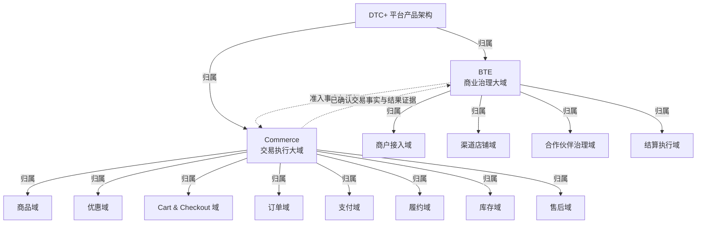

# DTC+ 平台产品架构总览

这份总览给产品架构负责人、产品负责人、域负责人和跨域协作者使用。读完后，应能快速判断 BTE 与 Commerce 为什么分开、12 个正式子域分别拥有什么事实、各域如何交换事实，以及哪些能力不属于正式子域。

本文是基于现有权威文档形成的派生阅读总览，不定义新的产品事实。《DTC+ 平台产品架构基线》仍是顶层大域、正式子域清单和顶层协作契约的权威来源；BTE 与 Commerce 内部关系分别以两份大域框架应用文档为依据；单域对象、生命周期和业务不变量以 `03 域设计/` 中的对应域契约为权威。[依据：《DTC+ 平台产品架构基线》“阅读边界”](DTC+%20平台产品架构基线.md#dtc-平台产品架构基线)

## 1. 架构结论

DTC+ 把平台产品事实划分为两个同级顶层大域：BTE 负责商业治理，Commerce 负责交易执行。两者不是父子域或系统模块，而是互相供给事实的同级责任边界。[依据：《DTC+ 平台产品架构基线》“顶层大域从哪里来”与“为什么是同级关系”](DTC+%20平台产品架构基线.md#1-顶层大域从哪里来)

正式子域共 12 个：BTE 包含商户接入域、渠道店铺域、合作伙伴治理域和结算执行域；Commerce 包含商品域、优惠域、Cart & Checkout 域、订单域、支付域、履约域、库存域和售后域。其中 9 个子域的域契约已经建立，结算执行域、优惠域和 Cart & Checkout 域保留了架构边界，正式域契约尚待建立。[依据：《DTC+ 平台产品架构基线》“正式子域清单”](DTC+%20平台产品架构基线.md#4-正式子域清单)

上图只表达归属和顶层事实供给，不表示业务流程时序。12 个子域及其顶层归属来自平台架构基线；BTE 与 Commerce 的双向协作来自顶层协作契约。[依据：《DTC+ 平台产品架构基线》“正式子域清单”与“顶层协作契约”](DTC+%20平台产品架构基线.md#4-正式子域清单)

## 2. 划分域的判断标准

域是能力和业务事实的权威归属边界。一个域唯一维护自己的对象、对象生命周期、业务不变量和域能力；相邻域只能引用事实、保存快照、发起协作或形成自己的汇总，不能直接改写来源域对象。[依据：《DTC+ 产品设计框架》“域：权威归属边界”](../01%20通用方法/DTC+%20产品设计框架.md#22-域权威归属边界)

| 判断标准 | 成立条件 | 架构含义 | 事实依据 |
|---|---|---|---|
| 稳定事实 | 拥有可长期存在的业务对象和结果证据 | 子域必须有自己的事实基础 | [平台架构基线“子域推导标准”](DTC+%20平台产品架构基线.md#3-子域推导标准) |
| 唯一归属 | 对象、状态、异常和结果证据只有一个归属域 | 不能建立第二真相源 | [平台架构基线“子域推导标准”](DTC+%20平台产品架构基线.md#3-子域推导标准) |
| 生命周期 | 能定义状态、触发条件、终态和修正规则 | 域负责事实如何演进 | [平台架构基线“子域推导标准”](DTC+%20平台产品架构基线.md#3-子域推导标准) |
| 域能力 | 能对外提供明确业务能力 | 展示和查询本身不足以形成子域 | [平台架构基线“子域推导标准”](DTC+%20平台产品架构基线.md#3-子域推导标准) |
| 业务边界 | 能说明非职责和相邻域协作 | 子域不能吞并相邻域事实 | [平台架构基线“子域推导标准”](DTC+%20平台产品架构基线.md#3-子域推导标准) |

页面、菜单、工作台、外部系统、接口、组织团队、执行模式、跨域流程，以及只做评估、监控、权限或通知的能力，均不能仅凭自身形态升格为子域。[依据：《DTC+ 平台产品架构基线》“子域推导标准”](DTC+%20平台产品架构基线.md#3-子域推导标准)

## 3. BTE：商业治理大域

BTE 拥有商户、店铺、Partner、服务授权、商业关系、服务产品和商业结算事实，不拥有 Commerce 的交易执行对象。它通过准入、授权、签约和结算协作，把商业主体及其服务关系治理为可被交易执行消费的可信前置事实。[依据：《DTC+ 平台产品架构基线》“顶层大域从哪里来”](DTC+%20平台产品架构基线.md#1-顶层大域从哪里来)；[《DTC+ BTE 产品框架应用》“BTE 应用框架的方式”](../03%20大域框架应用/DTC+%20BTE%20产品框架应用.md#1-bte-应用框架的方式)

### 3.1 BTE 子域划分

下表是对正式子域清单和事实族锚点的阅读汇总，不替代平台架构基线中的正式清单。

| 子域 | 权威拥有的核心事实 | 为什么独立 | 关键非职责 | 契约状态 | 事实依据 |
|---|---|---|---|---|---|
| 商户接入域 | 商户组织、法律主体、品牌空间、组织范围、入驻资格和上线审核 | 商业身份与准入事实独立于具体店铺和交易 | 不治理账号鉴权、店铺授权或交易对象 | 已建立 | [平台架构基线“BTE 子域推导”](DTC+%20平台产品架构基线.md#41-bte-子域推导)；[BTE 应用“事实族唯一归属”](../03%20大域框架应用/DTC+%20BTE%20产品框架应用.md#32-事实族唯一归属) |
| 渠道店铺域 | 平台、渠道、店铺、渠道授权、接单配置和回写结果 | 店铺和授权有独立生命周期，不能并入商户本体 | 不标准化渠道订单或履约结果 | 已建立 | [平台架构基线“BTE 子域推导”](DTC+%20平台产品架构基线.md#41-bte-子域推导)；[BTE 应用“四个子域的框架应用”](../03%20大域框架应用/DTC+%20BTE%20产品框架应用.md#2-四个子域的框架应用) |
| 合作伙伴治理域 | Partner 身份、能力画像、服务授权、服务产品和标准结算条款 | Partner 资格与授权独立于具体交易执行结果 | 不拥有 Partner 内部作业或 Commerce 执行结果 | 已建立 | [平台架构基线“BTE 子域推导”](DTC+%20平台产品架构基线.md#41-bte-子域推导)；[BTE 应用“事实族唯一归属”](../03%20大域框架应用/DTC+%20BTE%20产品框架应用.md#32-事实族唯一归属) |
| 结算执行域 | 结算周期、业务流水、人工流水、总账、对账、分账、发票、打款和银行回款 | 商业结算消费交易事实，但不能回写交易事实 | 不回写 Commerce 交易状态 | 边界保留，域契约待建立 | [平台架构基线“正式子域清单”](DTC+%20平台产品架构基线.md#4-正式子域清单)；[BTE 应用“四个子域的框架应用”](../03%20大域框架应用/DTC+%20BTE%20产品框架应用.md#2-四个子域的框架应用) |

### 3.2 BTE 子域关系

| 供给方 → 消费方 | 关系原语 | 交换内容 | 消费方责任边界 | 事实依据 |
|---|---|---|---|---|
| 商户接入域 → 渠道店铺域 | 引用 | 商户身份、组织范围、品牌空间和上线审核结论 | 渠道店铺域只引用商户范围，独立维护店铺、渠道授权和回写证据 | [BTE 应用“关键子域关系”](../03%20大域框架应用/DTC+%20BTE%20产品框架应用.md#31-关键子域关系) |
| 渠道店铺域 → 商户接入域 | 协作／汇总 | 店铺身份、授权状态、上线结果和回写证据 | 商户接入域形成自己的上线影响汇总，不重建店铺对象 | [BTE 应用“关键子域关系”](../03%20大域框架应用/DTC+%20BTE%20产品框架应用.md#31-关键子域关系) |
| 商户接入域 → 合作伙伴治理域 | 协作 | 商户范围、资源准入结论和商业准入证据 | 合作伙伴治理域独立维护 Partner 与服务授权事实 | [BTE 应用“关键子域关系”](../03%20大域框架应用/DTC+%20BTE%20产品框架应用.md#31-关键子域关系) |
| 商户接入域 → 结算执行域 | 引用 | 商户身份、数据范围和准入所需商业事实 | 结算执行域独立维护账期、流水、账单和资金执行事实 | [BTE 应用“关键子域关系”](../03%20大域框架应用/DTC+%20BTE%20产品框架应用.md#31-关键子域关系) |
| 渠道店铺域 → 结算执行域 | 快照 | 店铺身份、店铺级商业配置和渠道协作证据 | 结算执行域保留执行所需时点证据，不修改店铺授权 | [BTE 应用“关键子域关系”](../03%20大域框架应用/DTC+%20BTE%20产品框架应用.md#31-关键子域关系) |
| 合作伙伴治理域 → 结算执行域 | 快照 | Partner 资格、能力范围、服务授权、服务产品和标准结算条款 | 结算执行域按条款执行结算，不反向修改资格与授权 | [BTE 应用“关键子域关系”](../03%20大域框架应用/DTC+%20BTE%20产品框架应用.md#31-关键子域关系) |
| 结算执行域 → 合作伙伴治理域 | 协作／快照 | 已确认结算结果、罚则证据和服务表现证据 | 合作伙伴治理域保留评估证据并调整自己的服务授权，不修改结算对象 | [BTE 应用“关键子域关系”](../03%20大域框架应用/DTC+%20BTE%20产品框架应用.md#31-关键子域关系) |

BTE 内部的共同约束是：相邻子域不得直接改写对方对象，也不得为同一商户、店铺、Partner、服务授权或结算事实建立第二真相源。[依据：《DTC+ BTE 产品框架应用》“允许的关系原语与协作内容”](../03%20大域框架应用/DTC+%20BTE%20产品框架应用.md#33-允许的关系原语与协作内容)

## 4. Commerce：交易执行大域

Commerce 拥有商品、优惠、Cart & Checkout、订单、支付、履约、库存和售后的标准执行事实，不拥有商户资格、店铺授权、Partner 资格、服务签约和商业结算。八个子域共同服务渠道无关的交易执行内核，但不能因为同属 Commerce 就互相改写对象。[依据：《DTC+ 平台产品架构基线》“顶层大域从哪里来”与“Commerce 子域推导”](DTC+%20平台产品架构基线.md#1-顶层大域从哪里来)

### 4.1 Commerce 子域划分

下表是对正式子域清单和事实族锚点的阅读汇总，不替代平台架构基线中的正式清单。

| 子域 | 权威拥有的核心事实 | 为什么独立 | 关键非职责 | 契约状态 | 事实依据 |
|---|---|---|---|---|---|
| 商品域 | 标准 SKU、渠道商品、渠道商品映射、Partner 商品映射、商品资料和同步结果 | 商品身份与可履约映射不能归订单或库存 | 不决定订单是否可履约 | 已建立 | [平台架构基线“Commerce 子域推导”](DTC+%20平台产品架构基线.md#42-commerce-子域推导)；[Commerce 应用“事实族唯一归属”](../03%20大域框架应用/DTC+%20Commerce%20产品框架应用.md#32-事实族唯一归属) |
| 优惠域 | 优惠规则、优惠资格、优惠计算、优惠核销结果和优惠异常 | 优惠执行事实不能归 Marketing 活动或订单金额快照 | 不拥有 Marketing 活动策略或订单最终金额快照 | 边界保留，域契约待建立 | [平台架构基线“正式子域清单”](DTC+%20平台产品架构基线.md#4-正式子域清单)；[Commerce 应用“八个子域的框架应用”](../03%20大域框架应用/DTC+%20Commerce%20产品框架应用.md#2-八个子域的框架应用) |
| Cart & Checkout 域 | 购物车、结算会话、结算输入和放弃结算证据 | 售前交易准备事实不能归商品、支付或标准订单 | 不拥有支付结果或标准订单 | 边界保留，域契约待建立 | [平台架构基线“正式子域清单”](DTC+%20平台产品架构基线.md#4-正式子域清单)；[Commerce 应用“八个子域的框架应用”](../03%20大域框架应用/DTC+%20Commerce%20产品框架应用.md#2-八个子域的框架应用) |
| 订单域 | 标准订单、订单行、订单事件、渠道映射、订单快照和跨域汇总状态 | 订单事实不能被渠道、支付、履约或售后吞并 | 不拥有支付、履约、库存或售后执行事实 | 已建立 | [平台架构基线“Commerce 子域推导”](DTC+%20平台产品架构基线.md#42-commerce-子域推导)；[Commerce 应用“事实族唯一归属”](../03%20大域框架应用/DTC+%20Commerce%20产品框架应用.md#32-事实族唯一归属) |
| 支付域 | 消费者支付要求、支付指令、交易结果、风险、争议和证据 | 消费者支付不同于平台商业结算 | 不管理平台服务费或 Partner 商业结算 | 已建立 | [平台架构基线“Commerce 子域推导”](DTC+%20平台产品架构基线.md#42-commerce-子域推导)；[Commerce 应用“八个子域的框架应用”](../03%20大域框架应用/DTC+%20Commerce%20产品框架应用.md#2-八个子域的框架应用) |
| 履约域 | 发货需求、履约单、路由、任务、出库与逆向结果和物流轨迹 | 执行过程不能变成订单对象的一个字段 | 不改写订单原始事实或直接修改库存账 | 已建立 | [平台架构基线“Commerce 子域推导”](DTC+%20平台产品架构基线.md#42-commerce-子域推导)；[Commerce 应用“事实族唯一归属”](../03%20大域框架应用/DTC+%20Commerce%20产品框架应用.md#32-事实族唯一归属) |
| 库存域 | 逻辑仓、库存账、占用、释放、流水、备货结果、缺口和差异 | 逻辑库存必须有唯一真相源 | 不拥有履约任务或订单状态 | 已建立 | [平台架构基线“Commerce 子域推导”](DTC+%20平台产品架构基线.md#42-commerce-子域推导)；[Commerce 应用“事实族唯一归属”](../03%20大域框架应用/DTC+%20Commerce%20产品框架应用.md#32-事实族唯一归属) |
| 售后域 | 售后请求、售后行、资格、策略、决策、执行指令和售后事件 | 售后周期不能被订单、履约、支付或库存吞并 | 不吞并逆向履约、退货入库或退款支付 | 已建立 | [平台架构基线“Commerce 子域推导”](DTC+%20平台产品架构基线.md#42-commerce-子域推导)；[Commerce 应用“八个子域的框架应用”](../03%20大域框架应用/DTC+%20Commerce%20产品框架应用.md#2-八个子域的框架应用) |

### 4.2 Commerce 子域关系

| 供给方 → 消费方 | 关系原语 | 交换内容 | 归属边界 | 事实依据 |
|---|---|---|---|---|
| 商品域 → Cart & Checkout 域 | 引用／快照 | 标准 SKU、生效映射和结算时商品事实 | Cart & Checkout 域拥有结算会话与结算输入 | [Commerce 应用“关键子域关系”](../03%20大域框架应用/DTC+%20Commerce%20产品框架应用.md#31-关键子域关系) |
| 优惠域 → Cart & Checkout 域 | 协作 | 优惠资格、计算口径和优惠结果 | Cart & Checkout 域不代写优惠规则或资格事实 | [Commerce 应用“关键子域关系”](../03%20大域框架应用/DTC+%20Commerce%20产品框架应用.md#31-关键子域关系) |
| Cart & Checkout 域 → 订单域 | 协作 | 已确认结算输入 | 订单域形成标准订单；Cart & Checkout 域不拥有订单与订单事件 | [Commerce 应用“关键子域关系”](../03%20大域框架应用/DTC+%20Commerce%20产品框架应用.md#31-关键子域关系) |
| 商品域 → 订单域 | 引用／快照 | 标准 SKU、生效渠道商品映射和下单商品事实 | 订单域拥有订单快照和成交金额 | [Commerce 应用“关键子域关系”](../03%20大域框架应用/DTC+%20Commerce%20产品框架应用.md#31-关键子域关系) |
| 商品域 → 履约域 | 协作 | 可用 SKU、渠道映射和 Partner 商品映射 | 履约域拥有执行事实，不反向修改商品映射 | [Commerce 应用“关键子域关系”](../03%20大域框架应用/DTC+%20Commerce%20产品框架应用.md#31-关键子域关系) |
| 商品域 → 库存域 | 引用 | 标准 SKU 身份 | 库存域拥有库存数量、流水和缺口事实 | [Commerce 应用“关键子域关系”](../03%20大域框架应用/DTC+%20Commerce%20产品框架应用.md#31-关键子域关系) |
| 订单域 ↔ 支付域 | 协作／汇总 | 支付需要与已确认支付汇总 | 支付域拥有支付要求、指令、交易结果、风险和争议 | [Commerce 应用“关键子域关系”](../03%20大域框架应用/DTC+%20Commerce%20产品框架应用.md#31-关键子域关系) |
| 订单域 → 履约域 | 协作 | 标准订单与订单行事实 | 履约域拥有履约拆分与执行，订单域仍拥有订单 | [Commerce 应用“关键子域关系”](../03%20大域框架应用/DTC+%20Commerce%20产品框架应用.md#31-关键子域关系) |
| 履约域 → 订单域 | 汇总 | 已接受履约结果与实际数量 | 订单域形成自己的履约汇总，不直接生成出库事实 | [Commerce 应用“关键子域关系”](../03%20大域框架应用/DTC+%20Commerce%20产品框架应用.md#31-关键子域关系) |
| 履约域 ↔ 库存域 | 协作 | 占用、释放、记账证据需求，以及可用量、缺口和记账结果 | 库存域是逻辑库存真相源，不拥有履约任务 | [Commerce 应用“关键子域关系”](../03%20大域框架应用/DTC+%20Commerce%20产品框架应用.md#31-关键子域关系) |
| 售后域 → 履约域 | 协作 | 逆向履约或补发执行指令 | 履约域拥有运输、仓内协同和逆向执行结果 | [Commerce 应用“关键子域关系”](../03%20大域框架应用/DTC+%20Commerce%20产品框架应用.md#31-关键子域关系) |
| 售后域 → 支付域 | 协作 | 退款执行指令 | 支付域拥有退款指令和资金结果 | [Commerce 应用“关键子域关系”](../03%20大域框架应用/DTC+%20Commerce%20产品框架应用.md#31-关键子域关系) |
| 售后域 → 库存域 | 协作 | 退货商品处置意图 | 库存域拥有退货入库和库存处置事实 | [Commerce 应用“关键子域关系”](../03%20大域框架应用/DTC+%20Commerce%20产品框架应用.md#31-关键子域关系) |
| 履约域／支付域／库存域 → 售后域 | 协作／汇总 | 各来源域的已确认结果 | 售后域将结果作为关闭证据，不代写来源事实 | [Commerce 应用“关键子域关系”](../03%20大域框架应用/DTC+%20Commerce%20产品框架应用.md#31-关键子域关系) |
| 售后域 → 订单域 | 汇总 | 已确认售后结果 | 订单域维护自己的售后汇总，售后域不修改订单原始事实 | [Commerce 应用“关键子域关系”](../03%20大域框架应用/DTC+%20Commerce%20产品框架应用.md#31-关键子域关系) |

Commerce 内部的共同约束是：任何子域都不能直接改写相邻域对象；跨域流程只能编排域能力，不能借编排取得对象所有权。[依据：《DTC+ Commerce 产品框架应用》“允许的关系原语与协作内容”](../03%20大域框架应用/DTC+%20Commerce%20产品框架应用.md#33-允许的关系原语与协作内容)；[《DTC+ 平台产品架构基线》“Commerce 子域推导”](DTC+%20平台产品架构基线.md#42-commerce-子域推导)

## 5. BTE 与 Commerce 的顶层协作

BTE 与 Commerce 的顶层边界关联主要使用“协作”。Commerce 定位 BTE 的身份、范围和授权时使用“引用”；双方需要保留准入或结算评估时点事实时使用“快照”。供给、消费、准入、触发和结果接受是协作内容，不是新的关系类型。[依据：《DTC+ 平台产品架构基线》“为什么是同级关系”](DTC+%20平台产品架构基线.md#2-为什么是同级关系)

### 5.1 BTE 向 Commerce 供给

| BTE 供给事实 | Commerce 的使用方式 | 消费边界 | 事实依据 |
|---|---|---|---|
| 商户身份与范围 | 判断商户能否进入对应交易能力 | 只接受已准入的商户、组织、品牌空间和数据范围 | [平台架构基线“BTE 与 Commerce 协作：BTE 供给”](DTC+%20平台产品架构基线.md#51-bte-与-commerce-协作bte-供给) |
| 店铺身份与授权 | 建立商品映射和订单承接范围 | 只允许已接受店铺进入交易执行 | [平台架构基线“BTE 与 Commerce 协作：BTE 供给”](DTC+%20平台产品架构基线.md#51-bte-与-commerce-协作bte-供给) |
| Partner 资格与授权 | 判断谁可以承接任务和回传结果 | 只允许已授权 Partner 承接对应能力 | [平台架构基线“BTE 与 Commerce 协作：BTE 供给”](DTC+%20平台产品架构基线.md#51-bte-与-commerce-协作bte-供给) |
| 渠道事件与回写证据 | 验收事件送达、历史补拉和回写结果 | 作为外部证据，不成为 Commerce 的第二真相源 | [平台架构基线“BTE 与 Commerce 协作：BTE 供给”](DTC+%20平台产品架构基线.md#51-bte-与-commerce-协作bte-供给) |
| 前置异常事实 | 形成外部依赖影响或阻断 | Commerce 不创建同源异常 | [平台架构基线“BTE 与 Commerce 协作：BTE 供给”](DTC+%20平台产品架构基线.md#51-bte-与-commerce-协作bte-供给) |

Commerce 消费上述事实前必须校验身份、来源、范围和状态。未通过准入的事实只能形成阻断或外部依赖状态，不能推进 Commerce 标准对象。[依据：《DTC+ 平台产品架构基线》“BTE 与 Commerce 协作：BTE 供给”](DTC+%20平台产品架构基线.md#51-bte-与-commerce-协作bte-供给)

### 5.2 Commerce 向 BTE 供给

| Commerce 供给事实 | BTE 的使用方式 | 消费边界 | 事实依据 |
|---|---|---|---|
| 商品事实 | 服务匹配、计费口径或服务表现评估 | 读取标准 SKU、映射和商品快照，不改写商品事实 | [平台架构基线“BTE 与 Commerce 协作：Commerce 供给”](DTC+%20平台产品架构基线.md#52-bte-与-commerce-协作commerce-供给) |
| 订单事实 | 交易计费、罚则、赔付和服务评估 | 消费标准订单、订单行和订单事件 | [平台架构基线“BTE 与 Commerce 协作：Commerce 供给”](DTC+%20平台产品架构基线.md#52-bte-与-commerce-协作commerce-供给) |
| 支付事实 | 区分消费者支付与服务结算证据 | 不把消费者支付改写为商业结算对象 | [平台架构基线“BTE 与 Commerce 协作：Commerce 供给”](DTC+%20平台产品架构基线.md#52-bte-与-commerce-协作commerce-供给) |
| 履约事实 | Partner 服务表现、罚则和结算证据 | 消费发货、履约、出库与轨迹结果 | [平台架构基线“BTE 与 Commerce 协作：Commerce 供给”](DTC+%20平台产品架构基线.md#52-bte-与-commerce-协作commerce-供给) |
| 库存事实 | 服务能力和库存相关费用证据 | 消费逻辑仓、库存、占用、流水和缺口事实 | [平台架构基线“BTE 与 Commerce 协作：Commerce 供给”](DTC+%20平台产品架构基线.md#52-bte-与-commerce-协作commerce-供给) |
| 售后事实 | 赔付、罚则和逆向服务评估 | 消费售后请求、决策、执行指令和异常结果 | [平台架构基线“BTE 与 Commerce 协作：Commerce 供给”](DTC+%20平台产品架构基线.md#52-bte-与-commerce-协作commerce-供给) |

BTE 可以读取、引用或快照 Commerce 已确认事实，但不能回写订单、支付、履约、库存或售后状态。商业结算需要修正交易事实时，必须回到对应事实的归属域处理。[依据：《DTC+ 平台产品架构基线》“BTE 与 Commerce 协作：Commerce 供给”](DTC+%20平台产品架构基线.md#52-bte-与-commerce-协作commerce-供给)

## 6. 关系原语和责任边界

| 关系原语 | 含义 | 使用边界 | 事实依据 |
|---|---|---|---|
| 归属／组成 | 表达大域组成子域、子域拥有对象，或对象内部的稳定组成 | 只表达权威结构，不由参与或调用改变 | [产品设计框架“关系”](../01%20通用方法/DTC+%20产品设计框架.md#34-关系) |
| 引用 | 保存另一个对象的身份标识 | 引用方不获得来源事实的所有权 | [产品设计框架“关系”](../01%20通用方法/DTC+%20产品设计框架.md#34-关系) |
| 快照 | 保存来源对象某一时点的信息 | 服务本域判断，来源后续变化不覆盖快照，快照不回写来源 | [产品设计框架“关系”](../01%20通用方法/DTC+%20产品设计框架.md#34-关系) |
| 协作 | 双方通过归属明确的能力交换具有身份和业务语义的内容 | 不产生共同归属，也不允许直接改写对方对象 | [产品设计框架“关系”](../01%20通用方法/DTC+%20产品设计框架.md#34-关系) |
| 汇总 | 消费方依据一个或多个已确认结果形成本域状态或事实 | 来源事实仍归来源域 | [产品设计框架“关系”](../01%20通用方法/DTC+%20产品设计框架.md#34-关系) |

异常责任也按事实归属判断。商品映射缺失时，映射配置事实归商品域，订单域只维护订单影响，履约域只维护履约就绪影响；库存不足时，缺口事实归库存域，履约域维护执行阻断，订单域只消费确认结果。异常修正必须回到来源事实的归属域。[依据：《DTC+ Commerce 产品框架应用》“异常与域外边界”](../03%20大域框架应用/DTC+%20Commerce%20产品框架应用.md#34-异常与域外边界)

## 7. 不属于正式子域的能力与模式

| 能力或模式 | 架构定位 | 责任边界 | 事实依据 |
|---|---|---|---|
| Merchant Service Governance | 域外支撑能力 | 管理商户画像、服务等级、服务包、生效关系和匹配矩阵，只做标准与评估，不拥有 Commerce 对象 | [平台架构基线“域外支撑能力”](DTC+%20平台产品架构基线.md#7-域外支撑能力) |
| Customer Care | 域外支撑能力 | 管理客服请求、沟通记录、客服任务和服务协同，可以触发订单、履约或售后能力 | [平台架构基线“域外支撑能力”](DTC+%20平台产品架构基线.md#7-域外支撑能力) |
| Commerce 监控 | 域外支撑能力 | 读取各域事实形成总览、指标、下钻和告警入口，不另建业务真相 | [平台架构基线“域外支撑能力”](DTC+%20平台产品架构基线.md#7-域外支撑能力) |
| 标准与上线检查评估 | 域外支撑能力 | 输出标准、指标和评估结果，只触发治理动作，不直接改写业务对象 | [平台架构基线“域外支撑能力”](DTC+%20平台产品架构基线.md#7-域外支撑能力) |
| 身份权限 | 平台基础能力 | 管理账号、组织、角色、授权和认证，不属于 BTE 或 Commerce 子域 | [平台架构基线“域外支撑能力”](DTC+%20平台产品架构基线.md#7-域外支撑能力) |
| Marketing | Commerce 域外协作能力 | 可以发起活动和表达优惠诉求，不拥有优惠规则、资格或核销事实 | [Commerce 应用“异常与域外边界”](../03%20大域框架应用/DTC+%20Commerce%20产品框架应用.md#34-异常与域外边界) |
| 商家自履约 | Commerce 执行模式 | 由 Merchant 自管仓库、客服和发货，不因此建立新的子域或 Partner | [平台架构基线“外部能力输入边界”](DTC+%20平台产品架构基线.md#6-外部能力输入边界)；[产品设计框架“端”](../01%20通用方法/DTC+%20产品设计框架.md#21-端面向人的参与视角) |
| MoR | 交易托管 Partner 服务产品 | 服务产品不因参与交易而获得 Commerce 对象归属 | [平台架构基线“外部能力输入边界”](DTC+%20平台产品架构基线.md#6-外部能力输入边界) |
| FBF | 物理履约托管 Partner 服务产品 | 服务产品不因承接履约而成为子域 | [平台架构基线“外部能力输入边界”](DTC+%20平台产品架构基线.md#6-外部能力输入边界) |
| 客户、供应商、主体和收款方统一主数据 | BTE 横向治理能力 | 当前不升格为子域 | [BTE 应用“BTE 的能力收敛”](../03%20大域框架应用/DTC+%20BTE%20产品框架应用.md#4-bte-的能力收敛) |

Partner 服务与 Partner 端也不是同一个概念。Partner 服务是经过注册、能力评审和授权形成的协作契约；Partner 端只是人工入口。二者都不能绕过 Commerce 的对象归属、状态规则和权限边界。[依据：《DTC+ 产品设计框架》“端：面向人的参与视角”](../01%20通用方法/DTC+%20产品设计框架.md#21-端面向人的参与视角)

## 8. 当前契约状态与文档差异

### 8.1 已确认的建设状态

平台架构已经确认全部 12 个子域的责任边界，但边界确认不等于详细契约已经完成。结算执行域、优惠域和 Cart & Checkout 域仍处于“边界保留，域契约待建立”状态，其对象、生命周期和业务不变量不能由本总览推测补齐。[依据：《DTC+ 平台产品架构基线》“正式子域清单”](DTC+%20平台产品架构基线.md#4-正式子域清单)

### 8.2 需要保留的表述差异

1. BTE 关系表把“标准结算条款”作为合作伙伴治理域向结算执行域提供的快照；BTE 能力收敛章节又把“服务条款、计费口径”写入结算执行域。依据当前明确关系，本总览采用“合作伙伴治理域维护并供给标准结算条款，结算执行域按条款形成结算执行事实”的表达；标准条款与执行口径之间更细的对象边界仍需由正式域契约确认。[依据：《DTC+ BTE 产品框架应用》“关键子域关系”“事实族唯一归属”与“BTE 的能力收敛”](../03%20大域框架应用/DTC+%20BTE%20产品框架应用.md#31-关键子域关系)
2. Commerce 关系总图把“逆向、补发或退款指令”整体连向履约域，但关键关系表明确区分：逆向履约和补发交给履约域，退款执行交给支付域。本总览采用关键关系表中的明确责任划分，不把退款资金执行归入履约域。[依据：《DTC+ Commerce 产品框架应用》“Commerce 子域关系总图”与“关键子域关系”](../03%20大域框架应用/DTC+%20Commerce%20产品框架应用.md#3-commerce-子域关系总图)

## 9. 阅读与使用方式

需要确认顶层大域、正式子域和顶层协作契约时，以《DTC+ 平台产品架构基线》为权威；需要确认大域内部静态关系时，分别阅读《DTC+ BTE 产品框架应用》和《DTC+ Commerce 产品框架应用》；需要判断单域对象、生命周期、业务不变量、异常和标准时，继续阅读 `03 域设计/` 中的对应域契约。[依据：《DTC+ 平台产品架构基线》“阅读边界”](DTC+%20平台产品架构基线.md#dtc-平台产品架构基线)

本文中的关系图和关系表只表达静态归属与事实交换，不表达某个业务主题的执行时序、恢复步骤或建设顺序。具体业务流程不能从箭头方向直接推导。[依据：《DTC+ 平台产品架构基线》“阅读边界”](DTC+%20平台产品架构基线.md#dtc-平台产品架构基线)；[《DTC+ Commerce 产品框架应用》“Commerce 子域关系总图”](../03%20大域框架应用/DTC+%20Commerce%20产品框架应用.md#3-commerce-子域关系总图)
